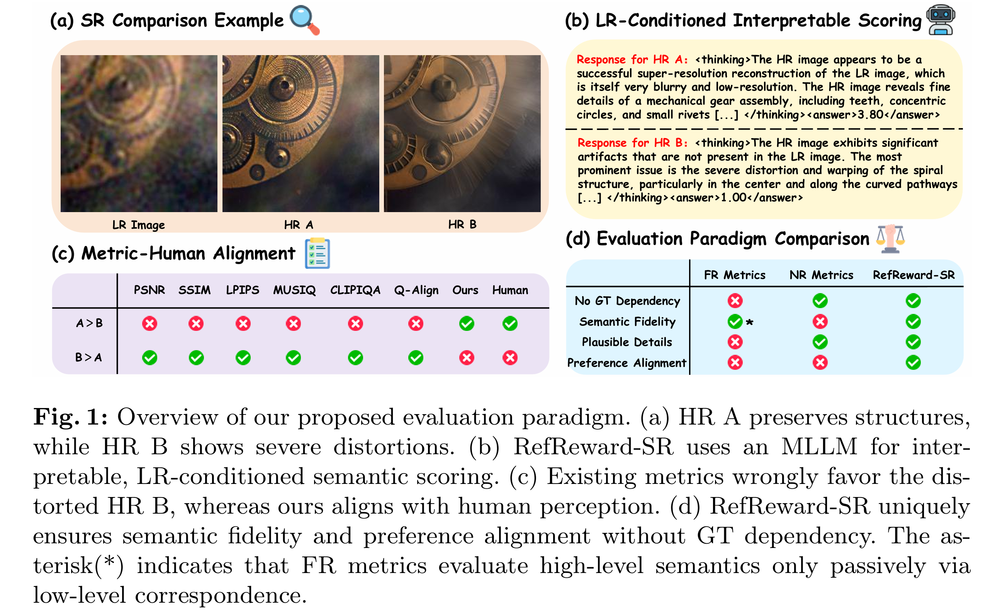
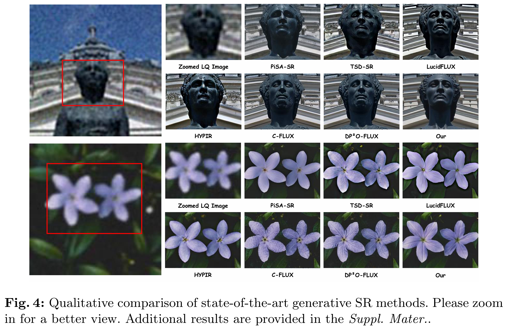

<h1 align="center"> (ECCV2026) RefReward-SR: LR-Conditioned Reward Modeling for Preference-Aligned Super-Resolution </h1>

    &nbsp;

---

> **Abstract:** Recent advances in generative super-resolution (SR) have greatly improved visual realism, yet existing evaluation and optimization frameworks remain misaligned with human perception. Full-Reference and No-Reference metrics often fail to reflect perceptual preference, either penalizing semantically plausible details due to pixel misalignment or favoring visually sharp but inconsistent artifacts. Moreover, most SR methods rely on ground-truth (GT)–dependent distribution matching, which does not necessarily correspond to human judgments. In this work, we propose RefReward-SR, a low-resolution (LR) reference-aware reward model for preference-aligned SR. Instead of relying on GT supervision or NR evaluation, RefReward-SR assesses high-resolution (HR) reconstructions conditioned on their LR inputs, treating the LR image as a semantic anchor. Leveraging the visual–linguistic priors of a Multimodal Large Language Model (MLLM), it evaluates semantic consistency and plausibility in a reasoning-aware manner. To support this paradigm, we construct RefSR-18K, the first large-scale LR-conditioned preference dataset for SR, providing pairwise rankings based on LR–HR consistency and HR naturalness. We fine-tune the MLLM with Group Relative Policy Optimization (GRPO) using LR-conditioned ranking rewards, and further integrate GRPO into SR model training with RefReward-SR as the core reward signal for preference-aligned generation. Extensive experiments show that our framework achieves substantially better alignment with human judgments, producing reconstructions that preserve semantic consistency while enhancing perceptual plausibility and visual naturalness.

---
